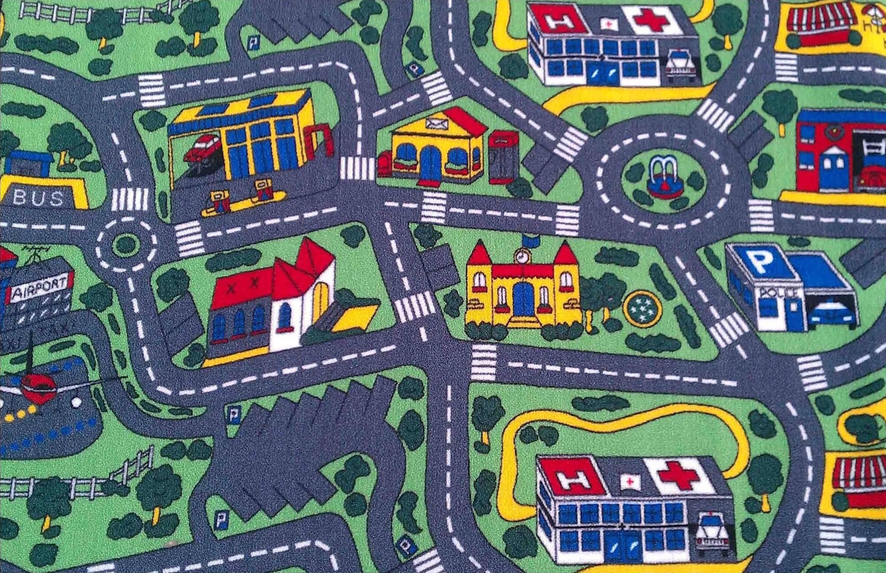
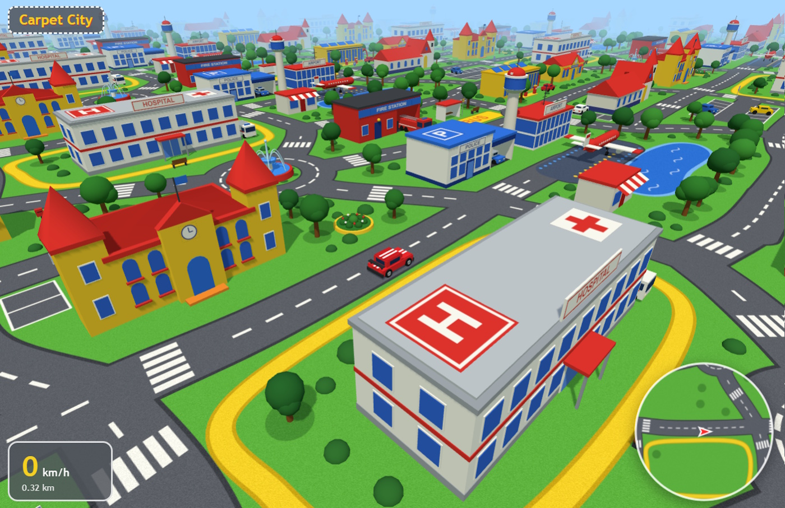

# Carpet City

Carpet City is a driving game where you explore a 3D world built inspired from the classic play rug. Relive the childhood nostalgia with this interactive experience as you navigate familiar roads, town loops, and buildings.

🚗 [Play Carpet City in your browser.](https://kovacsv.github.io/CarpetCity)

<table width="100%">
  <tr>
    <td width="50%" align="center">
      <br>
      <sup>The play rug that inspired the game (<a href="https://www.reddit.com/r/nostalgia/comments/apex2z/who_else_cruised_this_carpet">image source</a>).</sup>
    </td>
    <td width="50%" align="center">
      <br>
      <sup>Gameplay screenshot.</sup>
    </td>
  </tr>
</table>

<i>The game was entirely built using Claude Opus 5.5 and GitHub Copilot.</i>

## Development

Install dependencies:
```sh
npm install
```

Start the development environment:
```sh
npm run dev
```

Create release build:
```sh
npm run build
```
